# А2. C4 Level 2 — Container (11 сервисов + PostgreSQL + RabbitMQ, sync/async)

> **Что было в проекте:** [`docs/architecture-diagram.puml`](../../../docs/architecture-diagram.puml) и mermaid в [`docs/architecture.md`](../../../docs/architecture.md:5-59) есть, но **не различают
> sync/async**: все стрелки выглядят одинаково. Не отражены async-пути
> Switch → RabbitMQ → Logger (publisher confirms) и Card-Management outbox → RabbitMQ → Notification.
> **Что сделано:** Container-диаграмма с явной разметкой **sync (HTTP/JDBC)** — сплошная линия, **async (AMQP)** — пунктир, с указанием exchange/queue. Сверено с [`docker-compose.yaml`](../../../docker-compose.yaml).

## Диаграмма

```mermaid
C4Container
    title C4 Level 2 — Container: СМП (sync = сплошная, async = пунктир)

    Person(terminal, "POS-терминал", "Эмулятор")
    Person(merchant, "Мерчант/Эквайрер", "Эмулятор")
    Person(user, "Пользователь дашборда", "Оператор")

    System_Boundary(smp, "СМП") {
        Container(gw, "Gateway", "Spring Cloud Gateway", "Единая точка входа, rate limit, circuit breaker, маскирование логов", ":8080")
        Container(cms, "Card Management", "Spring Boot", "CRUD карт, Luhn, reserve/rollback, outbox событий", ":8081")
        Container(sw, "Switch / Router", "Spring Boot", "Маршрутизация по BIN, вызов Authorization, publish в Logger", ":8082")
        Container(auth, "Authorization", "Spring Boot", "APPROVED/DECLINED, лимиты, RRN/authCode, reversal", ":8083")
        Container(bin, "Bin Lookup", "Spring Boot", "Обогащение issuerId по BIN", ":8096")
        Container(term, "Terminal Simulator", "Spring Boot", "Эмуляция POS и сценариев", ":8085")
        Container(merch, "Merchant Acquirer", "Spring Boot", "Эмуляция мерчантов, MCC, комиссия", ":8084")
        Container(log, "Transaction Logger", "Spring Boot", "Приём/поиск транзакций, статистика, WebSocket", ":8088")
        Container(ns, "Notification Service", "Spring Boot", "Приём карточных событий, хранение уведомлений", ":8097")
        Container(web, "Web Dashboard", "React SPA", "KPI, графики, таблица, экспорт CSV", ":3000")
        Container(auto, "Autoscaler", "Docker CLI + shell", "Опциональный compose-профиль observability; масштабирование контейнеров", "compose service")
        ContainerDb(db, "PostgreSQL", "PostgreSQL 16", "Общая БД smp_db, Flyway-миграции", ":5432")
        ContainerQueue(rmq, "RabbitMQ", "RabbitMQ 3.13", "Асинхронный брокер, DLX/DLQ, publisher confirms", ":5672/:15672")
    }

    Rel(terminal, gw, "POST /api/transactions", "HTTP/JSON")
    Rel(merchant, gw, "POST /api/transactions", "HTTP/JSON")
    Rel(user, gw, "REST /api/dashboard/**", "HTTPS")
    Rel(user, log, "WebSocket /ws/transactions", "WS")
    Rel(gw, sw, "POST /api/internal/route", "HTTP sync")
    Rel(sw, auth, "POST /api/internal/authorize", "HTTP sync")
    Rel(auth, bin, "GET /api/bin/{bin}", "HTTP sync")
    Rel(auth, cms, "GET card / reserve / rollback", "HTTP sync")

    Rel(sw, rmq, "publish transaction.log → smp.transactions", "AMQP async")
    Rel(rmq, log, "consume transaction-log", "AMQP async")
    Rel(cms, rmq, "outbox publish card.* → smp.card-events", "AMQP async")
    Rel(rmq, ns, "consume card-notifications", "AMQP async")

    Rel(cms, db, "JDBC", "JDBC sync")
    Rel(auth, db, "JDBC limit_usage", "JDBC sync")
    Rel(log, db, "JDBC transactions", "JDBC sync")
    Rel(ns, db, "JDBC card_notifications", "JDBC sync")
    Rel(merch, db, "JDBC merchants/terminals", "JDBC sync")
```

## Разметка связей: sync vs async

| Связь                                            | Тип       | Протокол  | Evidence (код)                                                                                                                                                                                                                                                                         |
| ------------------------------------------------ | --------- | --------- | -------------------------------------------------------------------------------------------------------------------------------------------------------------------------------------------------------------------------------------------------------------------------------------- |
| Terminal/Merchant → Gateway                      | sync      | HTTP POST | [`application.yml`](../../../services/gateway/src/main/resources/application.yml:65-73)                                                                                                                                                                                                |
| Gateway → Switch                                 | sync      | HTTP      | [`application.yml`](../../../services/gateway/src/main/resources/application.yml:65-73) `RewritePath=/api/transactions → /api/internal/route`                                                                                                                                          |
| Switch → Authorization                           | sync      | HTTP      | [`AuthorizationClient`](../../../services/switch/src/main/java/com/processing/service/AuthorizationClient.java)                                                                                                                                                                        |
| Authorization → Bin Lookup                       | sync      | HTTP      | [`BinLookupClient`](../../../services/authorization/src/main/java/com/processing/authorization/client/BinLookupClient.java:58-61)                                                                                                                                                      |
| Authorization → Card Management                  | sync      | HTTP      | [`CardManagementClientImpl`](../../../services/authorization/src/main/java/com/processing/authorization/client/CardManagementClientImpl.java:32-133)                                                                                                                                   |
| Switch → RabbitMQ → Logger                       | **async** | AMQP      | [`LoggerClient`](../../../services/switch/src/main/java/com/processing/service/LoggerClient.java:38-51), [`RabbitMQConfig`](../../../services/switch/src/main/java/com/processing/config/RabbitMQConfig.java)                                                                          |
| Card Management outbox → RabbitMQ → Notification | **async** | AMQP      | [`OutboxEventProcessorImpl`](../../../services/card-management/src/main/java/com/processing/cardmanagement/services/OutboxEventProcessorImpl.java:32-46), [`RabbitMQConfig`](../../../services/card-management/src/main/java/com/processing/cardmanagement/config/RabbitMQConfig.java) |
| Card Management → PostgreSQL                     | sync      | JDBC      | [`CardRepository`](../../../services/card-management/src/main/java/com/processing/cardmanagement/repositories/CardRepository.java)                                                                                                                                                     |
| Authorization → PostgreSQL                       | sync      | JDBC      | [`LimitUsageRepository`](../../../services/authorization/src/main/java/com/processing/authorization/repositories/LimitUsageRepository.java)                                                                                                                                            |
| Logger → PostgreSQL                              | sync      | JDBC      | [`TransactionRepository`](../../../services/transaction-logger/src/main/java/com/processing/transactionlogger/repository/TransactionRepository.java)                                                                                                                                   |
| Notification → PostgreSQL                        | sync      | JDBC      | [`CardNotificationRepository`](../../../services/notification-service/src/main/java/com/processing/notification/repository/CardNotificationRepository.java)                                                                                                                            |
| Merchant Acquirer → PostgreSQL                   | sync      | JDBC      | [`application.yaml`](../../../services/merchant-acquirer/src/main/resources/application.yaml) (Flyway V71..V74)                                                                                                                                                                        |

## Сверка с docker-compose.yaml

Сервисные контейнеры (11) + инфраструктура (2):

| Контейнер                | Порт (host)         | Evidence                                                      |
| ------------------------ | ------------------- | ------------------------------------------------------------- |
| `smp-gateway`            | `${GATEWAY_PORT}`   | [`docker-compose.yaml`](../../../docker-compose.yaml:43-77)   |
| `smp-card-management`    | `${CARD_MGMT_PORT}` | [`docker-compose.yaml`](../../../docker-compose.yaml:79-111)  |
| `smp-switch`             | `${SWITCH_PORT}`    | [`docker-compose.yaml`](../../../docker-compose.yaml:113-145) |
| `smp-authorization`      | `${AUTH_PORT}`      | [`docker-compose.yaml`](../../../docker-compose.yaml:147-177) |
| `smp-bin-lookup`         | `8096`              | [`docker-compose.yaml`](../../../docker-compose.yaml:179-194) |
| `smp-notification`       | `8097`              | [`docker-compose.yaml`](../../../docker-compose.yaml:196-230) |
| `smp-terminal-simulator` | `8085`              | [`docker-compose.yaml`](../../../docker-compose.yaml:232-254) |
| `smp-merchant-acquirer`  | `${MERCHANT_PORT}`  | [`docker-compose.yaml`](../../../docker-compose.yaml:274-304) |
| `smp-transaction-logger` | `${LOGGER_PORT}`    | [`docker-compose.yaml`](../../../docker-compose.yaml:306-340) |
| `smp-dashboard`          | `${DASHBOARD_PORT}` | [`docker-compose.yaml`](../../../docker-compose.yaml:342-366) |
| `autoscaler`             | —                   | [`docker-compose.yaml`](../../../docker-compose.yaml:256-272) |
| `smp-postgres`           | `${DB_PORT}`        | [`docker-compose.yaml`](../../../docker-compose.yaml:4-22)    |
| `smp-rabbitmq`           | `5672/15672`        | [`docker-compose.yaml`](../../../docker-compose.yaml:24-41)   |

## Чего не хватало в проекте и что улучшено

| Чего не хватало                                     | Что сделано                                                       |
| --------------------------------------------------- | ----------------------------------------------------------------- |
| Не размечены sync/async                             | Сплошные линии = HTTP/JDBC, пунктир = AMQP                        |
| Не отражены async-пути (outbox, publisher confirms) | Добавлены Switch → RMQ → Logger и CMS outbox → RMQ → Notification |
| Не сверено с docker-compose                         | Таблица сверки контейнеров и портов                               |
| Не указаны exchange/queue на стрелках               | На async-связях указаны exchange и queue                          |
