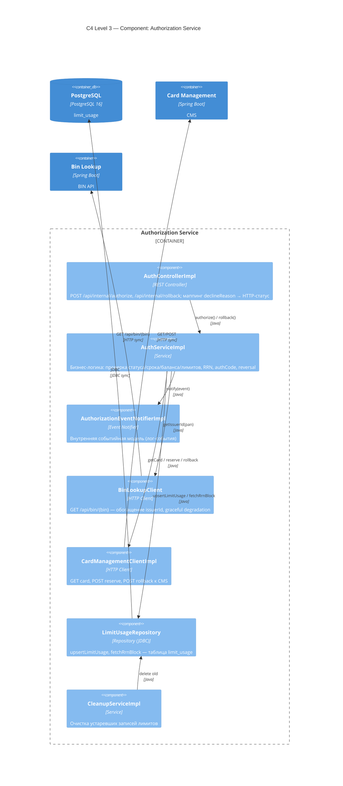
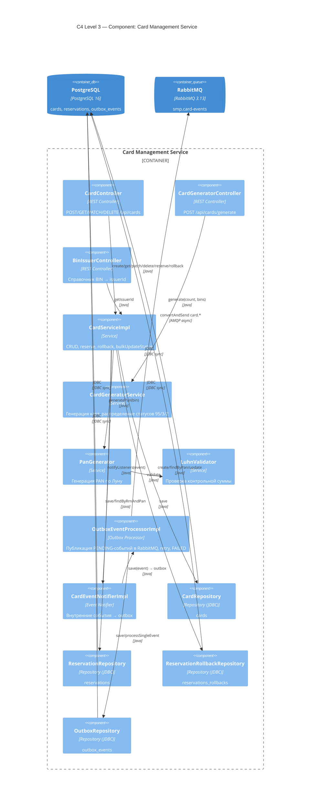

# А3. C4 Level 3 — Component (Authorization, Card-Management)

> **Что было в проекте:** компонентного уровня нет вообще — в документации нет схемы «что внутри сервиса».
> **Что сделано:** построены Component-диаграммы для двух ключевых сервисов, читая пакеты [`services/authorization/...`](../../../services/authorization/src/main/java/com/processing/authorization/) и [`services/card-management/...`](../../../services/card-management/src/main/java/com/processing/cardmanagement/).
> Показано: controller → service → client/repository, где HTTP-клиенты, где JDBC, где outbox.

## A3.1 Authorization Service

**Ключевые точки (для unit-тестов):**

- `AuthServiceImpl.authorize()` — чистая бизнес-логика, изолируется моками `BinLookupClient`,
  `CardManagementClient`, `LimitUsageRepository` ([`AuthServiceImpl.java`](../../../services/authorization/src/main/java/com/processing/authorization/services/AuthServiceImpl.java:43-176)).
- Порядок проверок: статус → срок → баланс → лимиты → резервирование
  ([`AuthServiceImpl.java`](../../../services/authorization/src/main/java/com/processing/authorization/services/AuthServiceImpl.java:72-170)).
- `DeclineOutcome` — единая точка кодов отказа ([`DeclineOutcome.java`](../../../services/authorization/src/main/java/com/processing/authorization/constants/DeclineOutcome.java)).
- HTTP-клиенты (`BinLookupClient`, `CardManagementClientImpl`) — кандидаты на mock в unit и на контракт в API-тестах.
- `LimitUsageRepository` — реальная БД, тестируется интеграционно.

## A3.2 Card-Management Service

**Ключевые точки (для unit-тестов):**

- `CardServiceImpl` — бизнес-логика CRUD/reserve/rollback, изолируется моками репозиториев
  ([`CardServiceImpl.java`](../../../services/card-management/src/main/java/com/processing/cardmanagement/services/CardServiceImpl.java)).
- `PanGenerator` + `LuhnValidator` — чистая логика, идеальна для unit.
- `OutboxEventProcessorImpl` — отдельный компонент публикации, тестируется изолированно
  ([`OutboxEventProcessorImpl.java`](../../../services/card-management/src/main/java/com/processing/cardmanagement/services/OutboxEventProcessorImpl.java:32-54)).
- Репозитории — реальная БД, тестируются интеграционно.

## Чего не хватало в проекте и что улучшено

| Чего не хватало                                     | Что сделано                                                       |
| --------------------------------------------------- | ----------------------------------------------------------------- |
| Компонентного уровня нет                            | Построены Component-диаграммы для Authorization и Card-Management |
| Не показано, где HTTP-клиенты, где JDBC, где outbox | Явно размечены типы компонентов и связи                           |
| Не видно порядка проверок в authorize()             | Отражён порядок: статус → срок → баланс → лимиты → резерв         |
