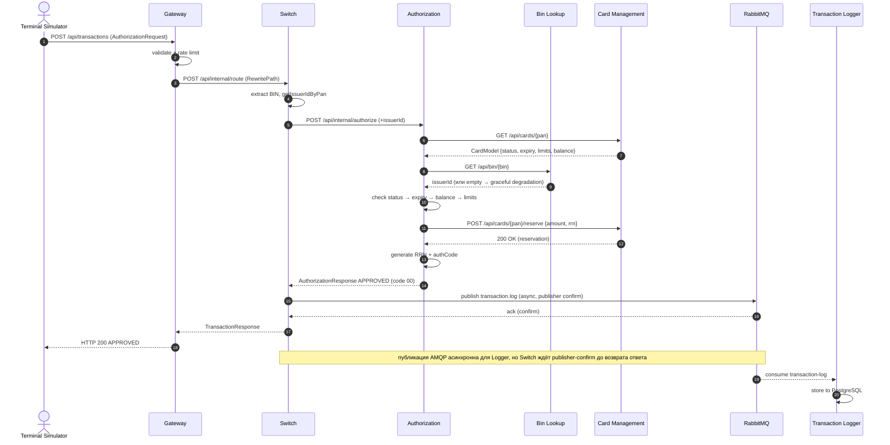
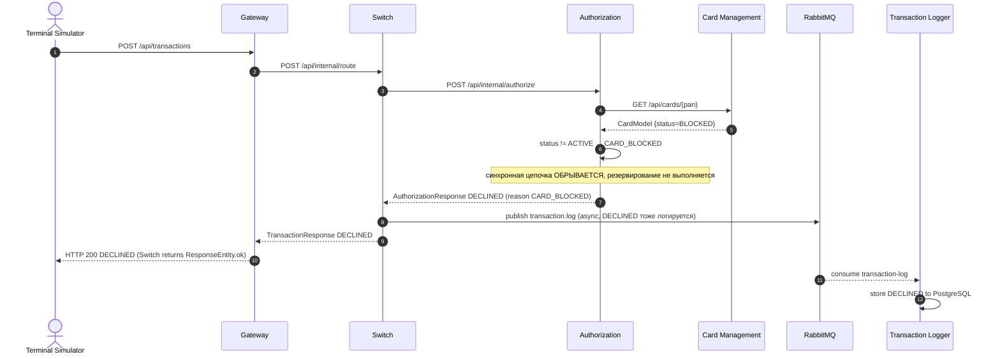

# А4. Sequence — путь транзакции (happy path + declined + reversal 0400)

> **Что было в проекте:** mermaid sequence в [`docs/architecture.md`](../../../docs/architecture.md:65-105) покрывает только happy path.
> **Что сделано:** три сценария — happy path, declined (карта BLOCKED), reversal (mti 0400 при отсутствии publisher-confirm). Показано, где sync-вызов, где async-«вилка».

## A4.1 Happy path (APPROVED)



**Evidence:** [`RouteService.route()`](../../../services/switch/src/main/java/com/processing/service/RouteService.java:55-99),
[`AuthServiceImpl.authorize()`](../../../services/authorization/src/main/java/com/processing/authorization/services/AuthServiceImpl.java:43-176),
[`LoggerClient.log()`](../../../services/switch/src/main/java/com/processing/service/LoggerClient.java:38-51).

## A4.2 Declined (карта BLOCKED)



**Evidence:** [`AuthServiceImpl.java:77-103`](../../../services/authorization/src/main/java/com/processing/authorization/services/AuthServiceImpl.java:77-103)
(ветка `!currCardStatus.equals(ACTIVE)` → `CARD_BLOCKED`),
[`AuthControllerImpl.java:76-85`](../../../services/authorization/src/main/java/com/processing/authorization/controller/AuthControllerImpl.java:76-85)
(внутренний Auth-контроллер маппит `CARD_BLOCKED` в HTTP 403; внешний Switch
перехватывает тело ответа и возвращает клиенту `ResponseEntity.ok`, поэтому
сквозной Gateway-ответ в этом сценарии — HTTP 200 с `status=DECLINED`).

## A4.3 Reversal (mti 0400) — нет publisher-confirm за 2s

```mermaid
sequenceDiagram
    autonumber
    actor T as Terminal Simulator
    participant GW as Gateway
    participant SW as Switch
    participant AUTH as Authorization
    participant CMS as Card Management
    participant RMQ as RabbitMQ

    T->>GW: POST /api/transactions
    GW->>SW: POST /api/internal/route
    SW->>AUTH: POST /api/internal/authorize
    AUTH->>CMS: GET /api/cards/{pan}
    CMS-->>AUTH: CardModel ACTIVE
    AUTH->>CMS: POST /api/cards/{pan}/reserve
    CMS-->>AUTH: 200 OK
    AUTH-->>SW: APPROVED (rrn)
    SW->>RMQ: publish transaction.log (publisher confirm, timeout 2s)
    RMQ--xSW: confirm НЕ получен за 2s (брокер недоступен)
    Note over SW: tryLog() вернул false для исходного APPROVED; Switch выполняет rollback синхронно
    SW->>AUTH: POST /api/internal/rollback (reversal mti=0400, rrn)
    AUTH->>CMS: POST /api/cards/{pan}/rollback
    CMS-->>AUTH: 200 OK (reservation откатана)
    AUTH-->>SW: RollbackResponse APPROVED
    SW-->>GW: AuthorizationResponse systemError (responseCode 96)
    GW-->>T: HTTP 200 DECLINED responseCode=96
```

**Evidence:** [`RouteService.java:84-92`](../../../services/switch/src/main/java/com/processing/service/RouteService.java:84-92)
(`if (!logged && STATUS_APPROVED) → rollback → systemError`),
[`LoggerClient.java:47-50`](../../../services/switch/src/main/java/com/processing/service/LoggerClient.java:47-50)
(`AmqpException → return false`),
[`application.yml`](../../../services/switch/src/main/resources/application.yml:10-11) (`publisher-confirm-type: correlated`),
[`docs/architecture.md:230`](../../../docs/architecture.md:230) (код 96).

## Где sync, где async

| Участок                                               | Тип       | Комментарий                                                                                       |
| ----------------------------------------------------- | --------- | ------------------------------------------------------------------------------------------------- |
| Terminal → Gateway → Switch → Authorization → CMS/BIN | **sync**  | HTTP запрос-ответ, клиент ждёт                                                                    |
| Switch → RabbitMQ → Logger                            | **async** | доставка в Logger через очередь; Switch ждёт confirm, а запись в БД остаётся eventual consistency |
| Switch → Authorization rollback (reversal)            | **sync**  | вызывается только при отсутствии confirm                                                          |
| CMS outbox → RabbitMQ → Notification                  | **async** | отдельный поток, не блокирует авторизацию                                                         |

## Чего не хватало в проекте и что улучшено

| Чего не хватало                      | Что сделано                                                                                  |
| ------------------------------------ | -------------------------------------------------------------------------------------------- |
| Только happy path                    | Добавлены declined (CARD_BLOCKED) и reversal (mti 0400)                                      |
| Не показана async-«вилка»            | Отмечено, что доставка в Logger асинхронна, но publisher-confirm ожидается до ответа клиенту |
| Не показан откат при сбое публикации | Добавлен сценарий rollback + responseCode 96                                                 |
