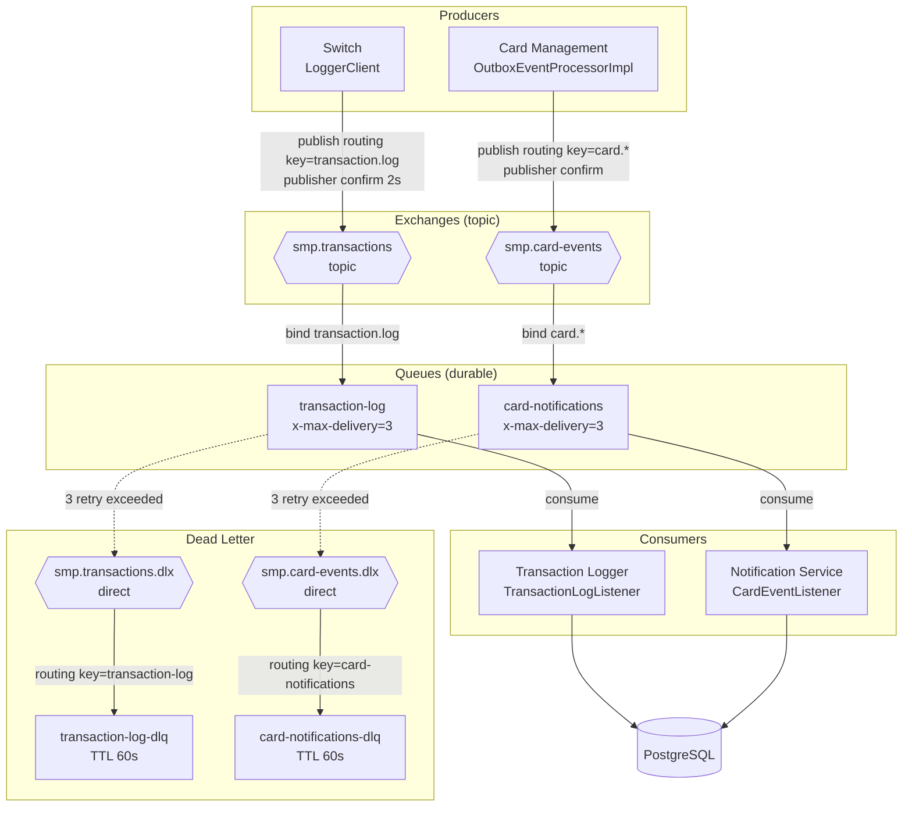

# А5. RabbitMQ-топология (exchange → queue → consumer, DLX/DLQ, confirms, retry)

> **Что было в проекте:** в [`docs/architecture.md:240-265`](../../../docs/architecture.md#240-265) есть **таблица** топологии и текстовое описание, но нет **диаграммы**.
> **Что сделано:** визуализирована топология с DLX/DLQ, publisher confirms (2s), retry (3, TTL 60s).

## Диаграмма

## Топология

| Exchange               | Тип    | Queue                    | Routing key          | Producer                 | Consumer             | Evidence                                                                                                                            |
| ---------------------- | ------ | ------------------------ | -------------------- | ------------------------ | -------------------- | ----------------------------------------------------------------------------------------------------------------------------------- |
| `smp.transactions`     | topic  | `transaction-log`        | `transaction.log`    | Switch                   | Transaction Logger   | [`RabbitMQConfig`](../../../services/switch/src/main/java/com/processing/config/RabbitMQConfig.java#22-59)                          |
| `smp.transactions.dlx` | direct | `transaction-log-dlq`    | `transaction-log`    | DLX                      | —                    | [`RabbitMQConfig`](../../../services/switch/src/main/java/com/processing/config/RabbitMQConfig.java#61-87)                          |
| `smp.card-events`      | topic  | `card-notifications`     | `card.*`             | Card Management (outbox) | Notification Service | [`RabbitMQConfig`](../../../services/card-management/src/main/java/com/processing/cardmanagement/config/RabbitMQConfig.java#26-76)  |
| `smp.card-events.dlx`  | direct | `card-notifications-dlq` | `card-notifications` | DLX                      | —                    | [`RabbitMQConfig`](../../../services/card-management/src/main/java/com/processing/cardmanagement/config/RabbitMQConfig.java#78-102) |

## Механика

| Механизм           | Значение                                         | Evidence                                                                                                                                                                                                                                                                              |
| ------------------ | ------------------------------------------------ | ------------------------------------------------------------------------------------------------------------------------------------------------------------------------------------------------------------------------------------------------------------------------------------- |
| Publisher confirms | `publisher-confirm-type: correlated`, timeout 2s | [`application.yml`](../../../services/switch/src/main/resources/application.yml#10-11), [`docs/architecture.md:230`](../../../docs/architecture.md#230)                                                                                                                               |
| Retry              | `x-max-delivery=3` (до 3 попыток)                | [`RabbitMQConfig`](../../../services/switch/src/main/java/com/processing/config/RabbitMQConfig.java#47), [`RabbitMQConfig`](../../../services/card-management/src/main/java/com/processing/cardmanagement/config/RabbitMQConfig.java#64)                                              |
| DLQ TTL            | 60 000 ms (60s)                                  | [`RabbitMQConfig`](../../../services/switch/src/main/java/com/processing/config/RabbitMQConfig.java#75), [`RabbitMQConfig`](../../../services/card-management/src/main/java/com/processing/cardmanagement/config/RabbitMQConfig.java#45)                                              |
| Outbox retry       | `maxRetryCount` из `app.outbox`, затем `FAILED`  | [`OutboxOptions`](../../../services/card-management/src/main/java/com/processing/cardmanagement/options/OutboxOptions.java), [`OutboxEventProcessorImpl`](../../../services/card-management/src/main/java/com/processing/cardmanagement/services/OutboxEventProcessorImpl.java#48-54) |
| Management UI      | `http://localhost:15672`, `smp`/`smp`            | [`docker-compose.yaml`](../../../docker-compose.yaml#24-41)                                                                                                                                                                                                                           |

## Поток сообщения и место отказа

1. **Switch** публикует `TransactionRequest` в `smp.transactions` с routing key `transaction.log`
   ([`LoggerClient.log()`](../../../services/switch/src/main/java/com/processing/service/LoggerClient.java#38-51)).
2. **Transaction Logger** потребляет очередь `transaction-log`
   ([`TransactionLogListener`](../../../services/transaction-logger/src/main/java/com/processing/transactionlogger/listener/TransactionLogListener.java#27-31)).
3. При исключении в consumer сообщение возвращается до 3 раз, затем уходит в `transaction-log-dlq` (TTL 60s).
4. **Card Management** через outbox публикует `card.*` в `smp.card-events`
   ([`OutboxEventProcessorImpl.processSingleEvent()`](../../../services/card-management/src/main/java/com/processing/cardmanagement/services/OutboxEventProcessorImpl.java#32-46)).
5. **Notification Service** потребляет `card-notifications`
   ([`CardEventListener`](../../../services/notification-service/src/main/java/com/processing/notification/listener/CardEventListener.java#36-54)).

## Чего не хватало в проекте и что улучшено

| Чего не хватало                                        | Что сделано                                     |
| ------------------------------------------------------ | ----------------------------------------------- |
| Топология описана текстом/таблицей, не визуализирована | Построена диаграмма exchange → queue → consumer |
| Не показаны DLX/DLQ визуально                          | Добавлены DLX/DLQ с TTL 60s                     |
| Не показаны publisher confirms и retry                 | Отмечены на диаграмме и в таблице механики      |
