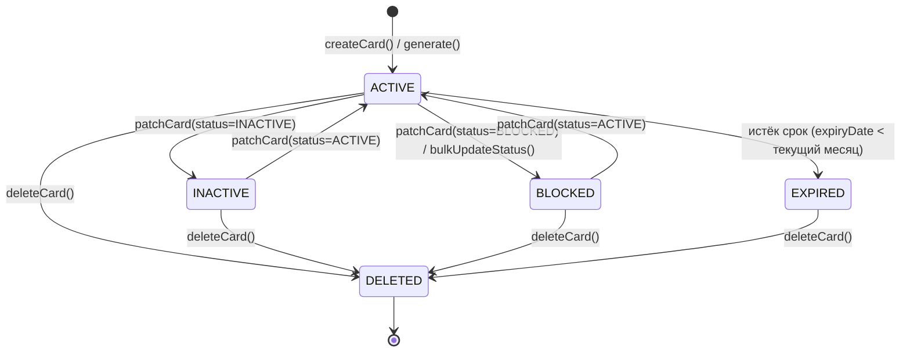
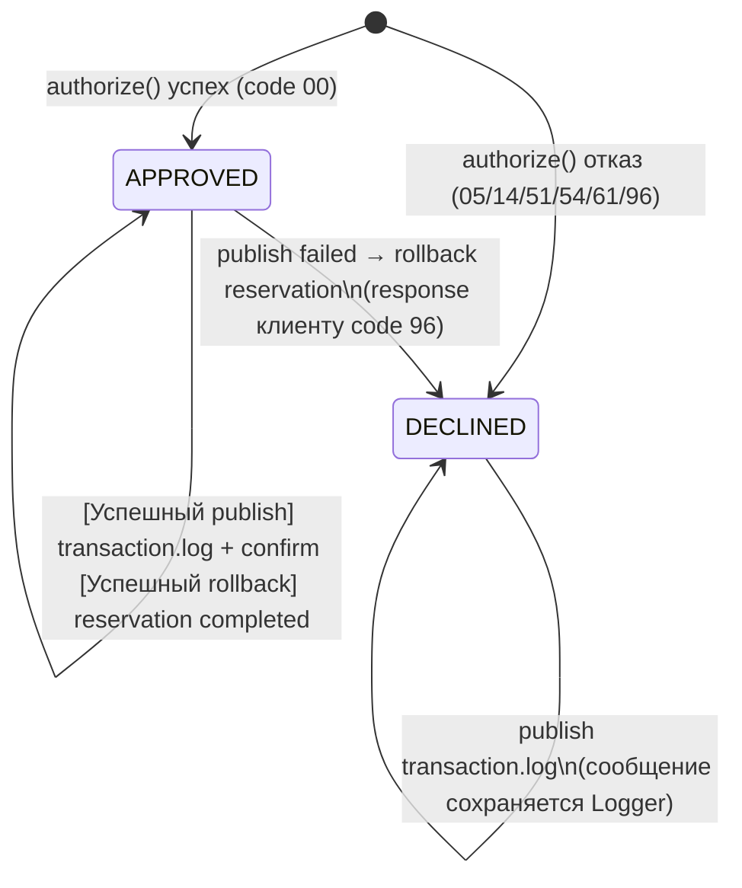

# А6. State-transition (Card.status + жизненный цикл Transaction)

> **Что было в проекте:** state-диаграмм нет. Есть enum [`CardStatus.java`](../../../services/card-management/src/main/java/com/processing/cardmanagement/models/CardStatus.java) и логика `authorize()`.
>**Что сделано:** построены диаграммы состояний для `Card.status` и жизненного цикла Transaction, собранные из кода.

## A6.1 Card.status

**Evidence:**

- Enum: [`CardStatus.java`](../../../services/card-management/src/main/java/com/processing/cardmanagement/models/CardStatus.java) — `ACTIVE, INACTIVE, BLOCKED, EXPIRED, DELETED`.
- Создание всегда `ACTIVE`: [`CardServiceImpl.createCard()`](../../../services/card-management/src/main/java/com/processing/cardmanagement/services/CardServiceImpl.java:47-55).
- Смена статуса: [`CardServiceImpl.patchCard()`](../../../services/card-management/src/main/java/com/processing/cardmanagement/services/CardServiceImpl.java:143-163),
  [`bulkUpdateStatus()`](../../../services/card-management/src/main/java/com/processing/cardmanagement/services/CardServiceImpl.java:230-264).
- Удаление → `DELETED`: [`CardServiceImpl.deleteCard()`](../../../services/card-management/src/main/java/com/processing/cardmanagement/services/CardServiceImpl.java:166-171).
- `EXPIRED` определяется в Authorization по сроку: [`AuthServiceImpl.java:105-112`](../../../services/authorization/src/main/java/com/processing/authorization/services/AuthServiceImpl.java:105-112).

### Влияние статуса на авторизацию

| Статус   | Результат authorize()               | Код | Evidence                                                                                                                                           |
| -------- | ----------------------------------- | --- | -------------------------------------------------------------------------------------------------------------------------------------------------- |
| ACTIVE   | продолжает проверки                 | —   | [`AuthServiceImpl.java:77`](../../../services/authorization/src/main/java/com/processing/authorization/services/AuthServiceImpl.java:77)           |
| INACTIVE | DECLINED `CARD_INACTIVE`            | 05  | [`AuthServiceImpl.java:91-96`](../../../services/authorization/src/main/java/com/processing/authorization/services/AuthServiceImpl.java:91-96)     |
| BLOCKED  | DECLINED `CARD_BLOCKED`             | 05  | [`AuthServiceImpl.java:85-90`](../../../services/authorization/src/main/java/com/processing/authorization/services/AuthServiceImpl.java:85-90)     |
| EXPIRED  | DECLINED `CARD_EXPIRED`             | 54  | [`AuthServiceImpl.java:79-84`](../../../services/authorization/src/main/java/com/processing/authorization/services/AuthServiceImpl.java:79-84)     |
| DELETED  | карта не найдена → `CARD_NOT_FOUND` | 14  | [`CardServiceImpl.getCard()`](../../../services/card-management/src/main/java/com/processing/cardmanagement/services/CardServiceImpl.java:112-116) |

## A6.2 Наблюдаемый жизненный цикл Transaction

**Evidence:**

- Статусы транзакции: [`TransactionStatus`](../../../services/common/src/main/java/com/processing/common/dto/transactionlogger/TransactionStatus.java) (`APPROVED`, `DECLINED`). Отдельных значений `ROLLED_BACK`, `LOGGED` и `PENDING` в модели нет.
- APPROVED/DECLINED: [`AuthServiceImpl.authorize()`](../../../services/authorization/src/main/java/com/processing/authorization/services/AuthServiceImpl.java:43-176).
- Откат резервирования при ошибке публикации: [`RouteService.java:87-92`](../../../services/switch/src/main/java/com/processing/service/RouteService.java:87-92),
  [`AuthServiceImpl.rollback()`](../../../services/authorization/src/main/java/com/processing/authorization/services/AuthServiceImpl.java:223-246). Это отдельная операция над reservation, а не новый `TransactionStatus`.
- Логирование: [`LoggerClient.log()`](../../../services/switch/src/main/java/com/processing/service/LoggerClient.java:38-51).

## Переходы → тест-кейсы

Каждый переход — отдельная проверка:

| Переход                                           | Тест-кейс       | Уровень         |
| ------------------------------------------------- | --------------- | --------------- |
| ACTIVE/BLOCKED → DECLINED                         | TC-NEW-01       | unit            |
| ACTIVE/expired date → DECLINED (54)               | TC-NEW-03       | unit            |
| ACTIVE/INACTIVE → DECLINED                        | —               | —               |
| DELETED → NOT_FOUND                               | —               | —               |
| APPROVED → rollback reservation (reversal)        | TC-NEW-13/16    | integration     |
| APPROVED/DECLINED → Logger (eventual consistency) | TC-NEW-12/18/19 | integration/e2e |

## Чего не хватало в проекте и что улучшено

| Чего не хватало                            | Что сделано                                       |
| ------------------------------------------ | ------------------------------------------------- |
| State-диаграмм нет                         | Построены диаграммы для Card.status и Transaction |
| Не показано влияние статуса на авторизацию | Таблица статус → результат authorize()            |
| Не связаны переходы с тест-кейсами         | Таблица переход → тест-кейс → уровень             |
